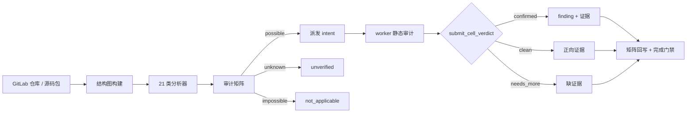

<div align="center">

# CodeScan-Artex

**接口 × 漏洞类型矩阵驱动的 AI 静态代码审计平台**

目前主要面向 Java / Spring / MyBatis 项目 · 三开于 ARTEX · 二开于 Ernket/CodeScan

</div>

---

## 这是什么

CodeScan-Artex 是一个面向**静态代码审计**的 LLM 多 Agent 平台。

它不运行被测应用、不发起业务请求、不编译业务源码，也不把“规则命中”直接当漏洞。

一次审计被拆成三步：

1. **建图**：从源码构建接口、调用链、DAO/XML、参数和守卫线索；
2. **算资格**：对每个「接口 × 漏洞类型」判断结构上是否可能存在该类风险；
3. **交给 worker**：只把 `possible` 的格子交给审计 Agent，由 worker 阅读源码后给出 `confirmed / clean / needs_more`。

核心产出不是零散的“疑似漏洞”，而是一张**可核对覆盖度的审计矩阵**。

<div align="center">

```text
接口 A × SQL 注入      → possible   → 已派发 → confirmed
接口 A × XSS           → impossible → 不适用（带 trace）
接口 B × 越权          → possible   → 已派发 → clean（有正向证据）
接口 C × 文件上传      → unknown    → 未验证（图不完整，不派）
```

</div>

---

## 本分支重点新增

- **GitLab 项目化审计**：以仓库 + 分支为项目身份，同一仓库可建立多个分支项目；
- **全量 + 增量审计**：全量建立矩阵基线，增量只审计变更影响面；
- **语义增量**：忽略注释、空白和纯格式变化，delta 通过方法/SQL 行范围匹配；
- **完整目标矩阵快照**：区分 `delta / inherited / new / removed / manual / observation`；
- **增量预审**：可否定自动候选、人工填写缺口类型、人工确认新增适用格；
- **访问模型**：简单模式回答业务问题，精细模式维护资源/角色/接口规则，结果注入 worker；
- **Worker 观察项**：审计过程中发现矩阵外风险时调用 `report_observation`；
- **Findings 继承**：沿基线任务链递归继承，不只继承最近一层；
- **审计记录**：按项目独立编号审计批次，和历史执行任务分开显示；
- **稳定性修复**：矩阵完成后停止 planner 继续补派、任务自动收尾、重复全量拦截、观察项派发互斥。

---

## 工作流



---

## GitLab 项目审计

### 全量审计

- 固定目标分支 HEAD 为 target commit；
- 下载并解压源码；
- 对目标完整源码生成矩阵；
- 创建执行任务并启动 worker；
- 任务成功后推进 `last_audited_commit`。

全量任务建立完整矩阵基线。发起前可选择快速 / 标准 / 深度档位；预计意图超过 800 或 ETA 超过 10 小时会要求人工确认。深度档保留全部矩阵格，标准档收敛 authz/SSRF，快速档只保留高价值接口和高信号类型。矩阵派发默认把 authz 按 Controller、SSRF 按 sink 聚合，并延迟导入 N/A 行；同一源码内容会复用 CallGraph 缓存。

### 增量预览

预览只读取 GitLab compare：

- 不下载源码归档；
- 不创建任务；
- 不调用 LLM；
- 展示未阅 / 已阅未审计、变更文件、diff 和审计缺口。

“标记已阅”不会推进审计基线，也不产生 finding。

### 增量准备

```text
基线源码
+ GitLab compare 得到的变更文件
= 目标提交的完整源码
```

对目标完整源码重新生成矩阵，然后：

1. 用变更行与 cell hints 求交，得到 `delta`；
2. 与基线任务矩阵做 key 对比，得到 `inherited / new / removed`；
3. 找出变更影响但没有可审格的接口，形成 `delta_gaps`；
4. 找出目标矩阵中新增、结构上适用、但未命中变更行的格，形成 `new applicable`。

### 增量矩阵来源

```text
delta        本次变更命中，默认审计
manual       人工在缺口里指定类型
observation  worker 审计中新增
inherited    基线已有结论，只读继承
new          目标有、基线没有
removed      基线有、目标没有
```

格 key 带 HTTP 方法，避免同一路径 GET/POST 被当成同一格：

```text
GET /api/appointments:authz
POST /api/appointments:authz
```

### 基线规则

- 只有审计成功后才推进 `last_audited_commit`；
- 标记已阅不推进审计基线；
- 下一次增量使用当前基线任务作为 base；
- 新提交在本次审计期间不会混入，留给下一次；
- force push、rebase 或目标不再是基线后代时，要求重新全量审计。

### 审计批次与执行任务

```text
审计批次 #1  → 项目内第 1 次审计发起记录
执行任务 #44 → 实际运行的 Agent 任务
```

审计批次按项目独立从 `#1` 开始；全局数据库 ID 只用于内部 API 和路由。

---

## 增量预审

开始增量审计前，项目详情页展示：

- **自动 delta 候选**：默认审计，可逐项否定；
- **未覆盖接口**：人工选择或输入漏洞类型；
- **新增适用格**：默认不审计，勾选后才纳入本次审计；
- **人工新增接口格**：填写方法、接口路径、漏洞类型和可选文件路径，用于分析器未覆盖的风险。

新增适用格是：

```text
目标矩阵中 applicable
+ 基线矩阵没有这个 key
+ 本次 diff 没有命中
```

它不是漏洞结论，也不是 worker 观察项。人工新增的接口格会作为 `manual` 来源加入本次增量任务，不要求出现在目标矩阵里。

---

## 访问模型

访问模型用于给 worker 提供 authz 业务参考，不改变分析器“只产 possible”的职责。

### 简单模式

回答业务问题：

```text
是否多端
管理端业务数据范围
管理端内部资料范围
客户端私有数据范围
是否存在客户端可访问的管理端接口
```

数据范围采用从宽到窄的层级：

```text
全部
本组织/部门
分配/归属
本人
不确定
```

公开资料默认允许客户端访问，不进入问卷；worker 需要结合源码确认资源确实公开。

### 精细模式

面向了解代码的使用者，提供 JSON 编辑器，可按角色、资源、操作、接口和范围定义规则。

未出现在规则中的接口或角色由 worker 返回 `needs_more`。

访问模型按任务快照，修改项目模型不会改写历史任务结论。

---

## Worker 观察项

worker 发现当前矩阵格之外的风险时可以调用：

```text
report_observation(method, url, vulnclass, summary, reason, evidence)
```

服务端规则：

- 接口处于本次 delta/manual 范围：创建 `origin=observation` 格并自动派发；
- 该格已有运行中的 intent：只记录，不重复派发；
- 该格已有结论：转为延后观察；
- 接口不在本次范围：只记录为延后事实，不创建矩阵格。

观察项新增的格属于本次授权范围，planner 不得以“只审计 delta/manual”为由压制它的 finding。

### 链式风险

跨接口、跨矩阵格的组合风险不塞回已完成的矩阵，而是在任务详情的“链式风险”页集中展示：

- 展示 worker 延后观察、涉及接口、关联 finding 和证据；
- 可单独开启某个链式风险审计，也可一键审计全部；
- 后续任务复制原任务源码并关联原任务，不重新打开原矩阵；
- 原任务矩阵完成后仍可保留这些风险，供后续人工处理。

---

## 漏洞覆盖面

### 接口级（17 类）

```text
authz / authn / sql-injection / command-exec / ssrf / file-upload
path-traversal / deserialization / xss / business_logic / xxe / csrf
open_redirect / ssti / ldap_injection / mass_assignment / race_condition
```

### 仓库级（4 类）

```text
secrets / crypto / dependency / sensitive_data
```

仓库级类型不占接口列，以合成的 `REPO` 行进入矩阵。

> 分析器输出的是结构证据，不是漏洞结论。白名单、参数化、转义、权限判断和业务范围都交给 worker 结合源码判断。

---

## 安全边界

**只做静态分析。** 平台运行期间不执行被测代码、不发起业务请求、不修改被测源码。

Agent 的通用文件工具只有：

```text
Read · Write · Edit · MultiEdit · LS · Glob · Grep
```

没有 `Bash`、`WebFetch`、`WebSearch`、MCP 工具或流量工具。危险工具在装配层移除，配置层即使误加也会在最终工具列表中被黑名单剔除。

唯一的外部源码搬运发生在**任务创建前**：服务端可以从 GitHub / GitLab 下载源码归档，或对 GitLab 项目执行 compare 并构造目标源码快照。Agent 本身没有网络权限。

---

## 快速开始

### 依赖

- Go **1.26+**
- Node.js / npm
- PostgreSQL
- Java **JRE 8+**（运行 callgraph sidecar / 按需反编译依赖；首次构建矩阵图需要 JDK 8+）

### 构建

```bash
git clone https://github.com/ALisCat/codescan-artex.git
cd codescan-artex

cp config.example.json config.json
# 编辑 config.json，填写 PostgreSQL 连接

cd web
npm ci
npm run build:static
cd ..

mkdir -p server/webui/dist
cp -a web/out/. server/webui/dist/

CGO_ENABLED=0 go build -tags embedui -trimpath -o artex ./cmd/artex
./start.sh
```

默认访问：

```text
http://localhost:7878
```

首次访问 `/setup` 设置管理员密码。

### 开发模式

```bash
./dev.sh
```

- 后端：`go run ./cmd/artex`
- 前端：`cd web && npm run dev`
- 测试：`go test ./...`（部分 server 集成测试需要 PostgreSQL 配置）

### LLM 配置

在 UI 的「LLM 配置」页填写供应商、模型和密钥；也可以使用环境变量：

```bash
export ANTHROPIC_API_KEY=sk-...
# 或
export OPENAI_API_KEY=sk-...
```

常用变量：

| 变量 | 作用 |
| --- | --- |
| `ARTEX_PG_DSN` | 直接指定 PostgreSQL DSN |
| `ARTEX_SKILL_DIR` | skill 根目录 |
| `ARTEX_LLM_PROVIDER` / `ARTEX_LLM_MODEL` / `ARTEX_LLM_BASE_URL` | 覆盖默认 LLM |
| `ARTEX_JAVA_LOCAL_REPO` | 本地 Maven 仓库 |

---

## 矩阵离线流水线

```bash
cd codeaudit

# 建图
python3 -m matrix.graph.build /path/to/source /tmp/graph.json

# 跑分析器
python3 -m matrix.run /tmp/graph.json \
  --analyzers authz,authn,sql-injection,command-exec,ssrf,file-upload,path-traversal,deserialization,xss,business_logic,xxe,csrf,open_redirect,ssti,ldap_injection,mass_assignment,race_condition,secrets,crypto,dependency,sensitive_data \
  --out /tmp/findings.json

# 生成矩阵格和任务书
python3 -m matrix.bind /tmp/graph.json /tmp/findings.json /tmp/bound

# 转成平台导入体
python3 -m matrix.mkimport /tmp/bound.cells.json /tmp/bound.tasks.json /tmp/import.json
```

回归入口：

```bash
cd codeaudit
python3 -m matrix.tests.run_all
```

---

## 目录结构

```text
agent/                 planner / worker / mainagent / 工具 / 提示词
server/                HTTP API、GitLab 项目审计、矩阵导入、观察项、完成门禁
db/                    PostgreSQL schema、ca_cells、project_audit_runs
web/                   Next.js 前端
codeaudit/
  matrix/
    graph/build.py      JavaParser + Spring + XML → graph.json
    analyzers/          21 类结构分析器
    guards/             语义守卫 → authz_model / authn_model
    run.py              graph → findings
    bind.py             findings → cells / tasks
    mkimport.py         cells/tasks → 平台导入体
  tools/                打包、评测、cellgen
  demo/                 评测语料与标注
```

关键文档：

- [`codeaudit/PLAN.md`](codeaudit/PLAN.md)
- [`codeaudit/GITLAB-PROJECT-PLAN.md`](codeaudit/GITLAB-PROJECT-PLAN.md)
- [`codeaudit/MATRIX-DESIGN.md`](codeaudit/MATRIX-DESIGN.md)
- [`codeaudit/matrix/README.md`](codeaudit/matrix/README.md)
- [`codeaudit/demo/EVAL-PROTOCOL.md`](codeaudit/demo/EVAL-PROTOCOL.md)

---

## 已知限制

- 语言覆盖以 Java / Spring / MyBatis 为主；
- 动态代理、反射、复杂泛型、跨模块调用可能进入 `unknown`；
- `possible` 只表示“值得审”，不表示漏洞成立；`impossible` 也不等于绝对安全；
- 守卫可能写错或可绕过，只作为 worker 线索；
- 依赖分析是粗筛，不包含完整 CVE/可达性结论；
- 新增适用格默认不自动审计，需要人工勾选；
- 范围外观察记录为事实，任务详情提供「链式风险」列表，可单独或批量开启后续审计；
- 评测语料是内部变异语料，不能替代真实项目 holdout。

---

## 安全与合规

- 只审计你拥有或已获得明确授权的代码；
- 不要用本平台审计来源不明的商业软件、他人私有仓库或敏感数据；
- 不要把本平台产出用于未授权披露、攻击、入侵或勒索；
- LLM 可能漏报、误报，结论必须人工复核后再用于决策；
- 平台本身不提供任何安全保证或合规背书。
