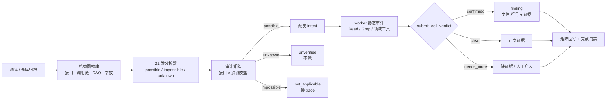

<div align="center">

# CodeScan-Artex

**接口 × 漏洞类型矩阵驱动的 AI 静态代码审计平台**

目前仅适用Java项目 · 三开于ARTEX · 二开于Ernket/CodeScan

</div>

---

## 这是什么

CodeScan-Artex 是一个面向**静态代码审计**的 LLM 多 Agent 平台。它不运行被测应用，不发请求，不编译业务源码，也不把“规则命中”直接当漏洞。项目在Ernket/CodeScan-Artex基础上修改，以个人粗浅代审经验进行功能添加，极度依赖原项目基础能力，想深入了解原项目底层架构可以前往原项目查看。

它把一次代码审计拆成三步：

1. **建图**：从源码构建接口、调用链、DAO/XML、参数和守卫线索；
2. **算资格**：对每个「接口 × 漏洞类型」判断结构上是否可能存在该类风险；
3. **派给 worker**：只把 `possible` 的格子交给审计 Agent，由 worker 读完源码后给出 `confirmed / clean / needs_more`。

核心产出不是一条条“疑似漏洞”，而是一张**可核对覆盖度的审计矩阵**：

```text
接口 A × SQL 注入      → possible   → 已派发 → confirmed
接口 A × XSS           → impossible → 不适用（带结构 trace）
接口 B × 越权          → possible   → 已派发 → clean（有正向证据）
接口 C × 文件上传      → unknown    → 未验证（图不完整，不派）
```

这样可以直接回答两个问题：

- 这个接口的这类风险，**到底审没审**？
- 如果没审，是**结构上不可能**，还是**图不完整/没有覆盖**？

---

## 和扫描器 / 通用 Agent 的区别

| | 传统 SAST / 规则扫描 | 通用 LLM 代码 Agent | CodeScan-Artex |
| --- | --- | --- | --- |
| 任务来源 | 规则命中 | Agent 自由探索 | **矩阵枚举**：接口 × 漏洞类型 |
| 是否审过 | 规则命中才有结果 | 过程不透明 | **每格都有状态**，N/A 也可解释 |
| 判断方式 | 模式匹配 | 一次性阅读 | 结构资格 + worker 语义确认 |
| 证据 | 规则位置 | 对话文本 | `文件:行号` + 代码片段 + 链路 |
| 误报处理 | 人工逐条看 | 不可复现 | 独立复核 / 人工介入 / 三态回写 |
| 过程 | 黑盒 | 黑盒 | 探索图 + 工具调用 + worker 过程检索 |

CodeScan-Artex 不替代 Semgrep、CodeQL、Joern 这类检测引擎。它做的是**编排、分流、证据化判定和覆盖率管理**。

---

## 安全边界

**只做静态分析。** 平台运行期间不执行被测代码、不发起业务请求、不修改被测源码。

Agent 的通用文件工具只有：

```text
Read · Write · Edit · MultiEdit · LS · Glob · Grep
```

没有 `Bash`、`WebFetch`、`WebSearch`、MCP 工具或流量工具。危险工具在装配层被移除，配置层即使误加也会在最终工具列表中被黑名单剔除。写入侧另有命令拦截规则兜底。

唯一的外部源码搬运发生在**任务创建前**：服务端可以从 GitHub / GitLab 下载公开仓库归档，产出与手动上传 zip 相同的本地只读目录。Agent 本身没有网络权限。

> 结论必须由源码证据支撑。N/A 表示“结构上未发现该类入口/sink”，不是“安全”；`clean` 也必须写出正向校验证据。

---

## 审计流程



### 1. 建图

`codeaudit/matrix/graph/build.py` 使用 JavaParser sidecar + Spring/MyBatis XML 解析，产出：

- 接口：method / url / handler / params / file:line
- 调用链：Controller → Service → DAO
- DAO / MyBatis XML / Wrapper 调用
- unresolved 调用（用于 `unknown`）
- 类、字段、方法、调用边

### 2. 分析器只回答“结构上有没有”

每个分析器输出三态：

| state | 含义 | 平台去向 |
| --- | --- | --- |
| `possible` | 流程里找到了该类 sink / 资源访问 | `applicable` → 派给 worker |
| `impossible` | 结构上没有该类入口/sink | `not_applicable` → 不派，保留 trace |
| `unknown` | 图不完整，sink 可能藏在未解析调用后 | `unverified` → 不派，等待补图或人工介入 |

分析器**不做**：

- 污点可达性结论；
- 白名单 / 参数化 / 转义是否有效的最终判断；
- 守卫是否能绕过；
- 归属校验是否写对；
- 漏洞成立性结论。

这些交给 worker。

### 3. Worker 判定

矩阵任务里，worker 只处理派发的格子，使用 Read / Grep / Glob 和领域工具核对源码，然后调用：

```text
submit_cell_verdict(cell_key, verdict, reason, evidence)
```

| verdict | 含义 | 要求 |
| --- | --- | --- |
| `confirmed` | 漏洞成立 | 先 `report_finding`，再回写；必须有文件:行号 + 代码片段 + 触发条件 |
| `clean` | 不存在该风险 | 必须有正向证据：哪一行做了什么校验/限制 |
| `needs_more` | 判不了 | 说明缺哪段源码、图或外部信息 |

矩阵任务完成前，平台会检查所有 `applicable` 格子：

- 仍有 `pending` → 自动补派并拒绝 `goal_met`；
- 仍有 `dispatched` → 拒绝完成；
- 只有全部有结论，任务才允许结束。

---

## 漏洞覆盖面

### 接口级（17 类）

| 类型 | key | 重点 |
| --- | --- | --- |
| 越权 | `authz` | principal / resource / 归属 / 角色 / 租户 |
| 认证/回调 | `authn` | token / session / 签名 / 时间戳 / nonce / 重放 |
| SQL 注入 | `sql-injection` | JDBC、MyBatis `${}`、Wrapper `last/apply/orderBy` |
| 命令/表达式注入 | `command-exec` | Runtime、ProcessBuilder、SpEL、OGNL、脚本引擎 |
| SSRF | `ssrf` | URL 客户端、内网地址、重定向 |
| 不安全反序列化 | `deserialization` | 原生反序列化、fastjson、XStream、gadget |
| 文件上传 | `file-upload` | Multipart、落盘路径、文件名、类型校验 |
| 路径穿越 | `path-traversal` | `Paths.get`、`File`、压缩包解压、下载 |
| XSS | `xss` | 响应写入、模板、前端渲染位置 |
| 业务逻辑 | `business_logic` | 金额/状态/租户/订单标识、幂等、状态机 |
| XXE | `xxe` | XML parser、DOCTYPE、外部实体 |
| CSRF | `csrf` | Cookie/Session、状态变更接口、SameSite/Origin |
| 开放重定向 | `open_redirect` | redirect 参数、白名单/相对路径 |
| SSTI | `ssti` | 模板/表达式引擎、Sandbox |
| LDAP 注入 | `ldap_injection` | filter 拼接、转义 |
| 批量赋值 | `mass_assignment` | 请求体直接绑定实体、敏感字段 |
| 竞态条件 | `race_condition` | 库存/号源/支付、锁、幂等、check-then-act |

### 仓库级（4 类）

| 类型 | key | 说明 |
| --- | --- | --- |
| 硬编码凭据 | `secrets` | JWT/DB/Redis/API Key、私钥；不输出密钥明文 |
| 弱加密 | `crypto` | AES/ECB、MD5/SHA1、硬编码密钥 |
| 依赖风险 | `dependency` | 已知高风险依赖粗筛；**不等于完整 CVE/可达性结论** |
| 敏感数据暴露 | `sensitive_data` | 日志/响应中的身份证、手机号、姓名等 |

仓库级类型不占接口列，但会以合成的 `REPO` 行进入矩阵。

SQL 注入分析器按“特征”关联，而不是“有 SQL 就派”：`${}`、字符串拼接、
动态表名/列名/ORDER BY、raw Wrapper 参数、无法解析的 SQL 会进入 `possible`；
纯 `#{}` / `?` + 固定模板、`.eq()`、常量 `orderBy("name")` 不关联。
白名单等守卫不消除特征，只作为 worker 证据。

---

## 越权与认证模型

### authz：不按方法名判断守卫

`codeaudit/matrix/guards/` 从方法行为抽取：

```text
principal 来源 + resource / role 条件 + 拒绝路径
```

支持：

- inline：`if (!Objects.equals(order.ownerId, user.id)) throw`
- helper：任意命名的方法体（`ensureAccess` / `validate` / `canSee`）
- 返回值：`if (!canSee(order, user)) throw`
- 声明式：`@PreAuthorize` / `@Secured` / `@RolesAllowed` / Shiro / Sa-Token
- 全局策略：HandlerInterceptor、WebMvcConfigurer、SecurityFilterChain、租户插件
- 死守卫：路径存在但拦截器未注册 → 记入 `required/unknowns`，不算 observed

产出 `authz_model`：

```json
{
  "principal": {"var": "user", "source": "UserContext.require()"},
  "resource": {"type": "Order", "source": "mapper.findById(id)"},
  "decisions": [
    {"kind": "ownership", "rule": "order.ownerId == user.id", "resolved": true}
  ],
  "required": ["authentication", "ownership"],
  "coverage": ["authentication", "ownership"],
  "gaps": [],
  "unknowns": []
}
```

`guards_seen` 只作为证据，不改变矩阵 state。守卫可能写错、可能可绕过，所以不能用它直接排除方向。

### authn：回调/令牌单独建模

`authn` 与 `authz` 分开：

- callback 入口要求 `signature` + `replay_protection`；
- token 入口要求 `authentication`；
- 普通接口返回 `impossible`，不生成 authn 任务；
- 产出 `authn_model`，带 `required/decisions/gaps/unknowns/search_policy`。

已有样例：saas 语料命中 `notifyCallBack` 支付回调无签名，demo 语料 0 误报。

### 搜索预算

`authz_model` / `authn_model` 会带 `search_policy`，由 worker 工具层执行：

```json
{
  "allow_global_search": true,
  "search_budget": 2,
  "search_kinds": ["ownership"],
  "search_patterns": ["owner|patientId|userId|checkOwner|ensureAccess"]
}
```

规则：

- 已命中的 required kind 不再搜索；
- 缺失 kind 允许 Glob/Grep 合计 2 次定向搜索；
- `allow_global_search=false` 时移除 Glob/Grep；
- 矩阵 authz/authn 格移除 LS/Write/Edit，禁止写笔记；
- 人工审计模式的提示词放宽为最多额外 Read 8 个文件、Grep/Glob 合计 4 次。

---

## 人工介入

右侧接口抽屉支持三种人工操作。

### 1. 强制审计不适用 / 未验证格子

N/A、hold、unverified 格子也可以人工发起 worker 审计。系统会带上该接口的 `flow / params`，但明确标注：

```text
这是人工发起，原判定不是安全结论。
flow 只作为入口参考，允许从 flow 扩展阅读。
```

### 2. 人工添加漏洞类型

分析器没覆盖的偏门类型（例如 SSO 回调 `relayState` 未校验、业务状态机绕过）可以直接补：

```text
POST /api/codeaudit/tasks/{id}/cells/manual-add
{
  "method": "POST",
  "url": "/api/sso/callback",
  "vulnclass": "sso-callback",
  "suggestion": "关注 relayState 是否绑定会话"
}
```

行为：

- 按 `(task, url, vulnclass)` 创建新格；已存在则复用；
- 只复制同接口的 `flow / params`；
- **不复制**其他类型的 sink、authz_model、guards 或 N/A 结论；
- 创建后立即生成 manual intent；
- 自定义类型使用通用 checklist，仍需 worker 给出源码证据。

### 3. 补齐旧格子的 flow

旧任务如果没有保存 `hints.flow`，人工审计前会从同接口其他格子补齐 `flow/params`。只更新 hints，不改 status、eligibility 或已有结论。

---

## 矩阵 UI

前端默认是**摘要视图**，也可切换到完整矩阵：

- 动态列：只给有分析结果的漏洞类型留列；
- 摘要视图：每个接口一行，直接显示漏洞 / 会派 / 守卫 / 未验 / 待定 / 通过；
- 完整矩阵：接口 × 类型，颜色区分 pending / dispatched / confirmed / clean / needs_more / hold / unverified / na；
- 右侧抽屉：查看该接口全部类型、结构流程、sink、守卫、判定原因和原始 hints；
- 单格抽屉：人工发起审计、查看 intent 和证据；
- 人工添加类型：支持已知类型和自定义类型。

矩阵格子的状态是覆盖率唯一来源：`clean` 与 `pending` 必须能区分。

---

## Planner / Worker 集成

矩阵不是绕开原有 Agent 流程，而是把「方向」结构化后交给原 planner/worker：

```text
planner add_intent(IntentSpec)
  → matrixGuardForTask 形状校验
  → matrixIntentResolver 查 ca_cells / 注入 cases+hints
  → AddIntent
  → Bind: MarkManual(cell, intent)
  → worker matrixIntentPrelude 渲染 flow/sites/model
  → worker submit_cell_verdict
```

矩阵任务中的 `add_intent` 必须结构化，至少提供：

```json
{
  "cell_keys": ["/api/x:authz"],
  "targets": [{"method": "POST", "url": "/api/x", "vulnclass": "authz"}],
  "scope": "endpoint | repo",
  "files": ["src/...java"],
  "endpoints": ["/api/x"]
}
```

只有 summary 的自由文本意图会被拒绝，避免 planner 重新全仓探索。

- 结构化 cell 补派不占 `matrix_planner_extra_limit`；
- 跨接口同类模式用 `scope=pattern`，必须带 `pattern` + `files/endpoints`；
- 真正的仓库级补派用 `scope=repo`；
- `pattern` / `repo` 都受额度限制；
- 任务完成门禁会阻止 `goal_met` 在 applicable 格子未完成时通过。

---

## 评测

内部 demo 使用独立标注和干净源码包，避免 worker 读到 `GROUND-TRUTH`、labels 或分析笔记。

历史回归结果：

| 语料 | 方向召回 | 误派 |
| --- | --- | --- |
| demo-v1（安全版） | 1/1 | 0/1 |
| demo-v2（5 处变异） | 10/10 | 0/10 |
| java-sec-code | 23/23 | hold 3（sec 变体） |

> 这些是矩阵规则迭代期的内部结果，不是对所有代码库的准确率承诺。最新规则仍需按 [`codeaudit/demo/EVAL-PROTOCOL.md`](codeaudit/demo/EVAL-PROTOCOL.md) 重新跑 holdout。

当前回归入口：

```bash
cd codeaudit
python3 -m matrix.tests.run_all
```

- 85 个分析器 fixture，覆盖 21 类分析器；
- demo v1/v2/fresh-clinic 回归；
- `BASELINE.json` 记录基线，`--check` 检测回归；
- 不依赖 PostgreSQL、不调用 LLM。

评测源码上传前请使用：

```bash
cd codeaudit
python3 tools/pack_source.py <源码目录> /tmp/source-clean.zip
```

该脚本会排除 `.git`、`target`、`build`、`node_modules`、`.audit`、`labels`、`GROUND-TRUTH`、`.md` 等评测污染文件。

---

## 快速开始

### 依赖

- Go **1.26+**
- Node.js / npm（构建前端）
- PostgreSQL（数据库；启动时自动幂等迁移）
- Java **JRE 8+**（运行 callgraph sidecar / 第三方依赖反编译；首次构建矩阵图还需要 JDK 8+ 编译 sidecar）

### 从源码构建

```bash
git clone https://github.com/ALisCat/codescan-artex.git
cd codescan-artex

cp config.example.json config.json
# 编辑 config.json，填 PostgreSQL 连接

cd web
npm ci
npm run build:static
cd ..

mkdir -p server/webui/dist
cp -a web/out/. server/webui/dist/

CGO_ENABLED=0 go build -tags embedui -trimpath -o artex ./cmd/artex
./start.sh
```

默认访问：

```text
http://localhost:7878
```

首次访问 `/setup` 设置管理员密码。

### 开发模式

```bash
./dev.sh
# 后端 + Next.js 热更新
```

- 后端：`go run ./cmd/artex`
- 前端：`cd web && npm run dev`
- 测试：`go test ./...`（部分 server 集成测试需要 PostgreSQL 配置）

### LLM 配置

在 UI 的「LLM 配置」页填写供应商、模型和密钥；也可以用环境变量：

```bash
export ANTHROPIC_API_KEY=sk-...
# 或
export OPENAI_API_KEY=sk-...
```

常用变量：

| 变量 | 作用 |
| --- | --- |
| `ARTEX_PG_DSN` | 直接指定 PostgreSQL DSN，优先于 `config.json` |
| `ARTEX_SKILL_DIR` | skill 根目录 |
| `ARTEX_LLM_PROVIDER` / `ARTEX_LLM_MODEL` / `ARTEX_LLM_BASE_URL` | 覆盖默认 LLM |
| `ARTEX_JAVA_LOCAL_REPO` | 本地 Maven 仓库，按需取 jar（只读） |

每个任务可以配置 LLM 配置链；worker `max_turns` 可配置，当前评测使用 15。这一阶段优先保证流程正确性，成本优化仍在进行中。

---

## 矩阵离线流水线

图形构建和分析器在 `codeaudit/` 下独立运行，不依赖平台服务。

```bash
cd codeaudit

# 0. 首次使用：编译 JavaParser callgraph sidecar（需要 JDK 8+）
cd tools/callgraph
CP="lib/javaparser-core-3.26.2.jar:lib/javaparser-symbol-solver-core-3.26.2.jar:lib/javassist-3.30.2-GA.jar:lib/guava-33.2.1-jre.jar:lib/failureaccess-1.0.2.jar:lib/jsr305-3.0.2.jar"
javac -cp "$CP" CallGraphDump.java
cd ../..

# 1. 建图
python3 -m matrix.graph.build /path/to/source /tmp/graph.json

# 2. 跑分析器（默认只跑 authz；全量需要显式列出）
python3 -m matrix.run /tmp/graph.json \
  --analyzers authz,authn,sql-injection,command-exec,ssrf,file-upload,path-traversal,deserialization,xss,business_logic,xxe,csrf,open_redirect,ssti,ldap_injection,mass_assignment,race_condition,secrets,crypto,dependency,sensitive_data \
  --out /tmp/findings.json

# 3. 生成矩阵格和任务书
python3 -m matrix.bind /tmp/graph.json /tmp/findings.json /tmp/bound
# 输出：/tmp/bound.cells.json /tmp/bound.tasks.json /tmp/bound.report.json

# 4. 转成平台导入体
python3 -m matrix.mkimport /tmp/bound.cells.json /tmp/bound.tasks.json /tmp/import.json

# 5. 导入任务
curl -X POST http://127.0.0.1:7878/api/codeaudit/tasks/<task_id>/import \
  -H 'Authorization: Bearer <token>' \
  -H 'Content-Type: application/json' \
  -d @/tmp/import.json
```

分析器也可以按类型单独跑：

```bash
python3 -m matrix.run /tmp/graph.json --analyzers authz,authn --out /tmp/auth.json
```

如果已经有一份 callgraph.json，可以跳过 Java 侧：

```bash
python3 -m matrix.graph.build /path/to/source /tmp/graph.json --callgraph /tmp/callgraph.json
```

---

## 目录结构

```text
agent/                 planner / worker / 工具 / 提示词 / 矩阵 intent 处理
server/                HTTP API、矩阵导入、人工审计、完成门禁
db/                     PostgreSQL schema 与 ca_cells 存储
web/                    Next.js 前端（矩阵摘要 / 矩阵 / 抽屉）
codeaudit/
  matrix/
    graph/build.py      JavaParser + Spring + XML → graph.json
    analyzers/          21 类结构分析器
    guards/             语义守卫 → authz_model / authn_model
    catalogs/           sink / 守卫 / 资源模式
    run.py              graph → findings
    bind.py             findings → cells / tasks
    mkimport.py         cells/tasks → 平台导入体
  tools/                打包、评测、cellgen、acceptance
  demo/                 v1 / v2 / fresh-clinic 与标注
  PLAN.md               二开计划书
  MATRIX-DESIGN.md      矩阵设计记录
```

关键文档：

- [`codeaudit/PLAN.md`](codeaudit/PLAN.md)：从 ARTEX 到代码审计平台的总体计划
- [`codeaudit/DEVELOPMENT-PLAN.md`](codeaudit/DEVELOPMENT-PLAN.md)：当前待开发项、优先级和验收标准
- [`codeaudit/GITLAB-PROJECT-PLAN.md`](codeaudit/GITLAB-PROJECT-PLAN.md)：GitLab 项目模块、全量/增量审计、每日检查与阶段验收
- [`codeaudit/MATRIX-DESIGN.md`](codeaudit/MATRIX-DESIGN.md)：矩阵状态机、分析器、守卫、补派、完成门禁
- [`codeaudit/matrix/README.md`](codeaudit/matrix/README.md)：图、分析器、guards、authn 契约
- [`codeaudit/matrix/OPEN-ISSUES.md`](codeaudit/matrix/OPEN-ISSUES.md)：已知缺口和优先级
- [`codeaudit/demo/EVAL-PROTOCOL.md`](codeaudit/demo/EVAL-PROTOCOL.md)：评测协议

---

## 已知限制

- **语言覆盖**：当前优先 Java / Spring / MyBatis；其他语言和框架尚未系统覆盖。
- **图不完整**：动态代理、反射、复杂泛型、跨模块调用可能进入 `unknown`，不会强行给结论。
- **分析器是结构召回**：`possible` 只代表“值得审”，不代表漏洞成立；`impossible` 也不等于绝对安全。
- **守卫不是排除器**：守卫可能写错或可绕过，当前只作为 worker 线索。
- **依赖分析仍是粗筛**：`dependency` 目前基于已知高风险依赖模式，不包含完整 CVE 数据库和可达性判定。
- **仓库级类型误报**：`secrets` / `crypto` / `sensitive_data` 仍需要人工或 worker 复核。
- **成本**：尚未按漏洞类型细化 `max_turns` 和输出预算；当前优化重点是流程正确性。
- **评测语料**：demo 是内部变异语料，不能替代真实项目 holdout；需要持续补充盲写样本。

---

## 安全与合规

- 只审计你拥有或已获得明确授权的代码；
- 不要用本平台审计来源不明的商业软件、他人私有仓库或敏感数据；
- 不要把本平台产出用于未授权披露、攻击、入侵或勒索；
- LLM 可能漏报、误报，结论必须人工复核后再用于决策；
- 平台本身不提供任何安全保证或合规背书。

---

## 开源协议

本项目采用 **GNU Affero General Public License v3.0（AGPL-3.0）**，完整条款见 [LICENSE](LICENSE)。

衍生作品必须同样以 AGPL-3.0 开源；若修改后通过网络向用户提供服务，需要向这些用户公开对应完整源码。

本项目按“现状（AS IS）”提供，不附带任何明示或默示担保。使用本工具产生的一切责任与后果由使用者自行承担。

---

## 致谢

项目基于 ARTEX / CodeScan-Artex 的探索图、planner/worker、LLM 配置、漏洞复核和多用户能力二开。代码审计矩阵、结构分析器、语义守卫、完成门禁和人工添加类型流程是在此基础上的扩展。

如果这个项目对你有帮助，欢迎提交 issue 或 PR；涉及分析器规则时，请同时附上最小复现源码和预期结论。
